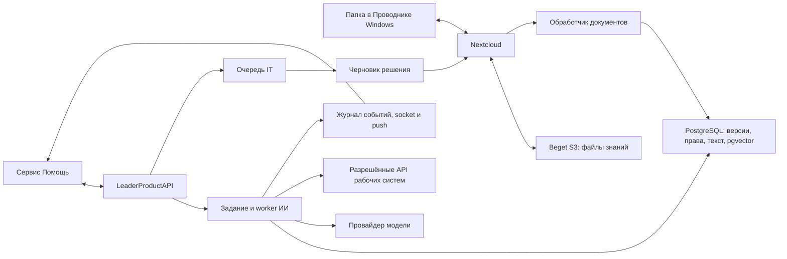

# Корпоративный ИИ-помощник и база знаний LeaderProduct

Обновлено: 1 ноября 2026 года.

Статус на 31 октября 2026: Nextcloud с HTTPS и внешним S3 синхронизирует `V:\Leader-Product-Cloud\База знаний`. Реализованы каталог, версии, очередь обработки, права и полнотекстовый поиск. По последнему решению пользователя развитие интерфейса проверки приостановлено: редактор кладёт проверенные документы в `Материалы компании`, а режим `folder` публикует успешно обработанную актуальную версию. Help worker умеет возвращать выдержки и источники без внешней модели, передавать неизвестные случаи в IT. Выбран OpenAI API (ChatGPT); ключ будет позже. Семантический поиск и генерация моделью пока не реализованы. Инструкция пилота: [help-knowledge-pilot.md](help-knowledge-pilot.md); эксплуатация: [deploy/knowledge/README.md](../deploy/knowledge/README.md); каталог: [knowledge-catalog.md](knowledge-catalog.md).

## 1. Что пользователь хочет получить

Дополнение 01.11.2026: реализован выключенный по умолчанию адаптер OpenAI Responses, проверка JSON/источников, ограниченные повторы, продление lease и отмена при уточнении/остановке worker. Добавлена проверка качества поиска на PostgreSQL с отдельными корпусом и вопросами. Инструкция и ограничения — [help-openai-adapter.md](help-openai-adapter.md). Ключ/модель и фактическая генерация ещё не подключены; работающий dev не переключён.

В сервисе «Помощь» сотрудник описывает рабочую проблему обычным сообщением, при необходимости прикладывает снимок экрана или документ. ИИ понимает контекст, находит инструкции компании и проверенные решения похожих случаев, задаёт необходимые вопросы и помогает решить проблему. Если решения нет или нужны полномочия специалиста, подключается IT в том же обращении.

ИИ работает на сервере. Пользователь может закрыть приложение, а подготовка ответа продолжится. Готовый ответ сохраняется в переписке и доставляется через существующую систему socket/push. При просмотре этого чата лишнее уведомление не показывается; в другом экране приложения используется внутренний баннер.

База знаний доступна как привычная папка в Проводнике Windows. Пользователь может создавать каталоги, читать и редактировать документы, добавлять новые файлы. Опубликованные изменения после синхронизации и индексации становятся доступны ИИ.

Помощник постепенно накапливает опыт из решённых обращений: самостоятельно готовит черновики инструкций, а ответственный сотрудник проверяет и публикует их. Следующие обращения используют этот подтверждённый опыт.

### Пример полного сценария

1. Сотрудник пишет: «В 1С не печатается накладная» и прикладывает скриншот.
2. Помощник учитывает текущий диалог, уточняет необходимое и ищет подходящую инструкцию.
3. Предлагает конкретные действия со ссылкой на источник; фиксирует результаты выполненных проверок.
4. Если действия не помогли, передаёт обращение в IT вместе со сводкой, вложениями и уже проверенными гипотезами.
5. IT устраняет проблему; результат подтверждается пользователем или специалистом.
6. ИИ создаёт файл-черновик решения и связывает его с исходным обращением.
7. Ответственный сотрудник исправляет и публикует материал. ИИ использует его после успешной индексации.

## 2. Принятые решения и открытые вопросы

| Область | Решение |
|---|---|
| Основной подход | RAG: поиск по доступным материалам перед генерацией ответа |
| Источники фактов | Инструкции и подтверждённые решения; актуальные рабочие данные — через разрешённые API |
| Интерфейс файлов | Nextcloud и официальный клиент синхронизации Windows |
| Папка Windows | `V:\Leader-Product-Cloud\База знаний` |
| Размещение Nextcloud | `155.212.144.191`, `/opt/leader-knowledge`, отдельный Compose-проект `leader-knowledge` |
| Файлы знаний | Созданный отдельный бакет у существующего S3-провайдера Beget |
| Подключение S3 | External Storage в Nextcloud: понятные имена объектов и структура папок |
| Основные папки | `Материалы компании`, `Рабочая область ИИ`, `Архив` |
| Поисковое хранилище | Сейчас PostgreSQL и полнотекстовый поиск; pgvector и embeddings — следующий этап |
| Созданные ИИ инструкции | Читаемые файлы Markdown `.md`, сначала в черновиках |
| Публикация знаний | В пилоте проверка редактором перед помещением в `Материалы компании`; автоматическая публикация конкретной версии после обработки. Ручные ограничения и отзыв сохраняют приоритет |
| Базовый исполнитель | Развиваем существующий серверный Help worker и журнал событий |
| Настоящий ИИ | OpenAI API выбран пользователем; ключ и модель позже. Сейчас `knowledge` возвращает реальные выдержки без генерации; `simulator` остаётся отдельным режимом dev/QA |

Пользователь выбрал `cloud.leader-product.ru` и создал DNS-запись. HTTPS настроен, сертификат действителен до 29 января 2027 года. Остаётся определить ответственных за разделы знаний, права сотрудников, условия передачи данных провайдеру ИИ и бюджет. Ресурсы сервера проверены, для пилота заданы ограничения; рабочую нагрузку и большие документы ещё нужно измерить.

## 3. Реквизиты созданного хранилища

Сведения перенесены из скриншотов пользователя, точные ключи затем получены текстом. Проверены HeadBucket, список объектов, запись/чтение/удаление отдельного тестового объекта. Анонимное чтение существующего тестового объекта отклонено; тестовый объект удалён.

| Поле | Значение |
|---|---|
| Провайдер | Beget, S3-совместимое объектное хранилище |
| Отображаемое имя сервиса | `Leader-AI-Docs` |
| Расположение в панели | `SPB` |
| Имя бакета | `66f2164cfa3e-leader-knowledge` |
| S3 endpoint | `https://s3.ru1.storage.beget.cloud` |
| Path-style URL | `https://s3.ru1.storage.beget.cloud/66f2164cfa3e-leader-knowledge` |
| Virtual-hosted URL | `https://66f2164cfa3e-leader-knowledge.s3.ru1.storage.beget.cloud` |
| SFTP-сервер | `sftp.ru1.storage.beget.cloud` |
| FTP-сервер, справочно | `ftp.ru1.storage.beget.cloud` |
| Поддомен непосредственно для S3 | Не подключён; используется endpoint Beget |
| Файловый портал Nextcloud | `https://cloud.leader-product.ru` |
| Требуемая политика | Закрытый доступ; документы не публикуются анонимно |

Оригиналы с Access key / Secret key сохранены без изменений в локальной папке `LeaderProductAPI/.env.knowledge.sources/`: `credentials-s3.png` и `credentials-sftp.png`. Их контрольные суммы совпадают с исходными скриншотами; доступ к папке ограничен текущим пользователем Windows и SYSTEM. Папка исключена из Git и Docker build context существующими правилами `.env.*`. Ключи не должны попадать в Markdown, логи, образ или мобильное приложение. По данным панели логин SFTP/FTP совпадает с Access key, пароль — с Secret key.

Точные рабочие реквизиты сохранены в приватном `LeaderProductAPI/.env.knowledge.local`; на VDS — в `/opt/leader-knowledge/secrets/knowledge.env`. Прежняя ошибка распознавания скриншота устранена. Файлы исключены из Git и Docker build context, значения не включаются в этот план. Данные входа Nextcloud сохранены отдельно в приватном `LeaderProductAPI/.env.nextcloud.local`.

Названия `KNOWLEDGE_S3_*` ниже относятся к подготовке файлового хранилища. Индексатор/API читают документы через `KNOWLEDGE_NEXTCLOUD_*` и не получают ключи S3 или пароль администратора Nextcloud. Не заменять ими существующие `S3_*`/`HELP_S3_*`, обслуживающие вложения приложения.

```dotenv
KNOWLEDGE_S3_ENDPOINT=https://s3.ru1.storage.beget.cloud
KNOWLEDGE_S3_BUCKET=66f2164cfa3e-leader-knowledge
KNOWLEDGE_S3_ACCESS_KEY=<точное значение из панели провайдера>
KNOWLEDGE_S3_SECRET_KEY=<точное значение из панели провайдера>
KNOWLEDGE_SFTP_HOST=sftp.ru1.storage.beget.cloud
KNOWLEDGE_FTP_HOST=ftp.ru1.storage.beget.cloud
```

Совместимость SDK и Nextcloud проверена с регионом подписи `ru1`, HTTPS и path-style. Метка `SPB` в панели не является значением настройки S3 region. Endpoint передаётся без имени бакета; hostname в Nextcloud — `s3.ru1.storage.beget.cloud`.

## 4. Архитектура и границы ответственности



- **S3** содержит исходные файлы. Новая база знаний не смешивается с вложениями, APK и резервными копиями приложения.
- **Nextcloud** управляет файлами, пользователями, синхронизацией и файловыми версиями. Его собственная служебная БД отделена от таблиц приложения.
- **Обработчик знаний** читает материалы через WebDAV/API Nextcloud, извлекает текст и обновляет индекс. Он использует файловые права и отдельный статус публикации.
- **PostgreSQL приложения** хранит каталог знаний, проверенные версии, извлечённый текст, поисковые векторы, доступы и ссылки на источники ответов.
- **Worker ИИ** получает доступные знания, контекст обращения и результаты инструментов; сохраняет результат независимо от состояния телефона.

Для Nextcloud предусматриваются сервисы приложения, PostgreSQL, Redis и cron, отдельные постоянные тома для конфигурации и служебных данных, HTTPS и резервные копии. S3 сокращает необходимость хранить оригиналы документов на диске VDS, но Nextcloud всё равно требует места для конфигурации, служебных данных и временных файлов.

Используется именно **внешнее S3-хранилище**. Режим Primary Object Storage не выбираем: он хранит имена/папки в БД Nextcloud, содержимое под внутренними идентификаторами и требует исключительного доступа к бакету.

Обычные изменения пользователя и запись файлов ИИ идут через Nextcloud. Прямое изменение S3/SFTP допустимо как административная операция с последующей сверкой: оно может не сразу отразиться в файловом кэше, истории и событиях Nextcloud.

## 5. Организация папок и публикация

По уточнению пользователя выделяем три области: материалы, которые добавляют сотрудники; рабочие файлы, которые готовит ИИ; материалы, которые больше не используются. Тематическая иерархия находится внутри этих областей. Пример структуры внутри созданного бакета:

```text
Материалы компании/
  Рабочие системы/
    1С/
    Лидер Продукт/
  Оборудование/
    Принтеры/
    Сканеры и ТСД/
  Рабочие процессы/
    Склад/
    Заказы и отгрузки/
  Регламенты/
Рабочая область ИИ/
  Разборы обращений/
  Черновики инструкций/
  На проверке/
Архив/
  Материалы компании/
  Рабочая область ИИ/
```

| Область | Кто и что делает | Использование в ответах сотрудникам |
|---|---|---|
| `Материалы компании` | Пользователь и ответственные сотрудники добавляют инструкции, регламенты и документы; сюда же после проверки поступают полезные инструкции, подготовленные ИИ | Только действующие опубликованные версии в пределах прав сотрудника |
| `Рабочая область ИИ` | ИИ разбирает случаи, сохраняет структурированные сводки и результаты проверок, подготавливает и улучшает черновики; ответственный специалист проверяет готовые материалы | Рабочие файлы не считаются подтверждёнными знаниями и не входят в общий поиск ответов |
| `Архив` | Ответственный сотрудник убирает устаревшие или отклонённые материалы; сохраняются исходный путь, причина и дата архивирования | Исключён из обычных ответов; доступен для истории уполномоченным сотрудникам |

Пример: `Рабочая область ИИ/Черновики инструкций/Не печатается накладная.md` → `Рабочая область ИИ/На проверке/Не печатается накладная.md` → после проверки и публикации `Материалы компании/Рабочие системы/1С/Не печатается накладная.md`. Не нужно создавать второй независимый экземпляр опубликованной инструкции в папке ИИ. Происхождение и предыдущие ревизии сохраняются в каталоге.

Служебному пользователю ИИ разрешена работа с черновиками в своей области. Публикация в `Материалы компании`, изменение утверждённых оригиналов и архивирование проходят через отдельные разрешённые операции с аудитом. Папка `Разборы обращений` содержит краткие факты, выполненные действия и оставшиеся вопросы, а не автоматически общедоступные копии переписок; её права не могут быть шире прав на исходные сведения. Рабочие материалы конкретного обращения могут использоваться для продолжения этой же задачи при сохранении её прав доступа.

Имена папок — удобная организация, но не самостоятельный механизм защиты. Права на публикацию и чтение проверяются сервером. Изменение названия папки не должно повышать доступ сотрудника.

- В выбранном режиме `folder` проверенный редактором файл помещается в `Материалы компании`. После синхронизации и успешного извлечения сервер публикует текущую версию. Новые документы этой области доступны всем сотрудникам с доступом к «Помощи», поэтому права записи в неё выдаются только доверенным редакторам. Интерфейс проверки в приложении для этого не нужен.
- Изменение файла создаёт новую ревизию. С момента обнаружения изменения прежняя версия исключается из поиска; новая автоматически публикуется после успешной обработки. Ручные ограничения аудитории и отзыв не сбрасываются. Альтернативный режим `manual` сохраняет обязательное ручное подтверждение каждой версии.
- Отозванный документ сразу исключается из выдачи после подтверждённого события отзыва; физическая очистка индекса может быть фоновой.
- Рабочая область ИИ и архив не участвуют в общем поиске ответов. Успешная сверка переноса в архив исключает материал из поиска. Возвращая материал в `Материалы компании`, редактор подтверждает его актуальность; явный ручной отзыв требует отдельного снятия через публикацию.
- Перемещение и переименование сохраняют идентичность документа и связи с обращениями.
- Пропажа файла при сетевой ошибке не считается удалением. Удаления подтверждаются успешной сверкой источника.
- В разделе знаний видны состояния «Синхронизируется», «Ожидает проверки», «Индексируется», «Доступен ИИ», «Ошибка обработки» и время последней сверки.

Публикуемая версия должна иметь устойчивую копию содержимого или ссылку на сохранённую ревизию и хеш. Изменяемый файл по одному пути не является надёжной ссылкой на исторический источник ответа. Для версий/служебных объектов выделяется закрытая техническая область без доступа обычного пользователя.

## 6. Подготовка данных и поиск

1. Получить список изменений через поддерживаемые механизмы Nextcloud. Использовать периодическую полную сверку как восстановление после пропущенных событий.
2. Дождаться завершённой загрузки, проверить формат и ограничения; временные файлы Office и незавершённые загрузки не индексировать.
3. Извлечь текст из Markdown/TXT, PDF с текстовым слоем и DOCX. Сканы, изображения и сложные таблицы добавить отдельным этапом с OCR/проверкой качества.
4. Разбить материал по смысловым разделам, сохраняя заголовки, последовательности действий, страницы и связи с исходным документом.
5. Сохранить версии извлекателя и модели поисковых векторов, хеш содержимого и права доступа.
6. Построить полнотекстовый и векторный индекс; опубликованную ревизию переключать только после успешной подготовки.
7. При запросе совместить поиск по точным словам/кодам ошибок и поиск по смыслу; при необходимости выполнить дополнительное ранжирование.

Разрешённые документы отбираются до отправки контекста модели. При приблизительном векторном поиске отдельно проверяется полнота результатов с фильтрами доступа. Права повторно проверяются при открытии источника и при публикации отложенного ответа, если доступ успел измениться.

Кэш учитывает организацию, доступ сотрудника, версии материалов и настройки поиска. Отзыв материала или прав инвалидирует соответствующие результаты. Смена модели векторов выполняется через новый индекс и проверяемое переключение, без смешивания несовместимых векторов.

## 7. Логика ответа ИИ

Контекст включает последние сообщения, проверяемое краткое содержание предыдущего диалога, уточнения, вложения, выполненные проверки и их результаты. Полная история всех чатов компании в запрос модели не отправляется.

Порядок работы: принять сообщение → сохранить задание → собрать доступный контекст → найти знания → при необходимости запросить рабочую систему → подготовить ответ/уточнение/передачу в IT → сохранить и доставить результат.

- Ответ содержит понятные действия, область применимости и раскрываемые источники с версиями/разделами. Идентификаторы источников проверяет сервер.
- Если данных недостаточно, ИИ задаёт короткий уточняющий вопрос. Не выдаёт предположение за установленную причину.
- В интерфейсе отображаются реальные этапы: поиск инструкции, проверка статуса, подготовка ответа. Это события выполнения, а не выдуманный журнал внутренних размышлений модели.
- Новое сообщение во время работы дополняет текущую задачу и делает старую попытку неактуальной. Устаревший ответ не публикуется после уточнения, остановки или передачи в IT.
- Внешний вызов модели не удерживает транзакцию БД. Длительные этапы имеют контроль времени, продление lease, отмену и сохраняемые промежуточные результаты.
- Повтор выполнения после сбоя не должен дублировать сообщение или действие в рабочей системе. Для внешних операций используются устойчивые ключи идемпотентности и проверка результата.
- Ошибки/лимиты провайдера приводят к ограниченным повторам и понятному завершению либо передаче в IT.

Реальная модель подключается через адаптер провайдера. Её выбирают на примерах компании с учётом русского языка, терминов, вложений, стоимости, задержки и условий обработки данных. При внешнем провайдере выбранные фрагменты документов и переписки покидают инфраструктуру компании; это учитывается при выборе и настройке.

## 8. Передача в IT и действия в рабочих системах

Основания передачи: явная просьба пользователя, отсутствие пригодных источников, противоречия, неудачные попытки решения, необходимость полномочий IT, исчерпание бюджета времени/попыток либо недоступная необходимая интеграция. Самооценка уверенности модели не является достаточным критерием.

В то же обращение добавляются причина передачи и сводка: проблема, окружение, проверенные действия, результаты, вложения и использованные источники. После передачи автоматические публичные ответы ИИ прекращаются. Позже можно добавить отдельные приватные подсказки специалисту.

Сначала интеграции работают на чтение: статус заказа, обмена с 1С, доступность сервиса. Затем добавляются конкретные разрешённые действия. Сервер проверяет полномочия, параметры, необходимость подтверждения, повторное выполнение и результат. Произвольные SQL/SSH-команды модели не предоставляются. Документы и сообщения рассматриваются как данные и не могут расширять полномочия инструментов.

Обращение закрывается по подтверждённому результату; генерация ответа сама по себе не доказывает решение.

## 9. Как ИИ учится на обращениях

Дополнение 01.11.2026: после закрытия обращения запланировать долговечное серверное задание с задержкой (предлагаемый старт — 30 минут). Оно выбирает: ничего не менять, создать инструкцию, дополнить существующую, предложить переработку или передать на проверку. Повторное открытие/новые сообщения отменяют устаревший анализ. Подробные состояния, защита опубликованных файлов, конфликты редакций и этапы — [план обработки закрытых обращений](help-resolution-learning-plan.md). Это следующий этап, ещё не работающий обработчик.

Весь анализ, WebDAV-выгрузка и доступ к рабочим системам выполняются с VDS; компьютер разработчика не является сетевым шлюзом или исполнителем. Опубликованные инструкции ИИ самостоятельно не перезаписывает.

После подтверждённого решения фоновый обработчик выделяет симптомы, условия, причину, неудачные попытки и успешные действия. Он создаёт Markdown-черновик в `Рабочая область ИИ/Черновики инструкций/`, удаляя секреты и частные сведения, не предназначенные для общей инструкции. Область доступа нового материала определяется отдельно.

Готовый черновик переходит в `Рабочая область ИИ/На проверке/`. Ответственный специалист принимает, исправляет, отклоняет или объединяет его с существующей статьёй. Подтверждённая инструкция публикуется в соответствующем тематическом разделе `Материалы компании/`. Повторные похожие обращения должны дополнять материал, а не создавать дубликаты. Все решения сохраняют происхождение: обращение, сообщения и проверивший сотрудник.

Повторное открытие обращения, отрицательный результат или изменение регламента создают сигнал пересмотра связанной статьи. Популярность ответа и сам факт закрытия чата не заменяют проверку применимости решения.

Само общение не переобучает параметры модели. Для первой версии «обучение» означает пополнение проверяемой базы знаний. Настоящее дообучение рассматривается позже для конкретных задач на очищенных примерах, с отдельной оценкой качества и возможностью отката.

## 10. Предлагаемые данные и модули

| Сущность | Основное назначение |
|---|---|
| `KnowledgeSource` | Источник Nextcloud, корень, состояние синхронизации и курсор |
| `KnowledgeDocument` | Устойчивая идентичность, путь, раздел, владелец и действующая публикация |
| `KnowledgeVersion` | Хеш/содержимое ревизии, автор, утверждение, срок проверки и отзыв |
| `KnowledgeChunk` | Текст, раздел/страница, вектор и версия индексации |
| `KnowledgeAccess` | Права по организациям, группам, отделам и ролям |
| `KnowledgeIngestionJob` | Извлечение/индексация, повторы, lease и ошибки |
| `KnowledgeCandidate` | Черновик из обращения и решение редактора |
| `HelpResolution` | Подтверждение результата и применённое решение |
| `HelpKnowledgeReviewJob` | Отложенный анализ закрытого обращения, ревизия входа, lease/fencing, отмена и повторы |
| `HelpAnswerSource` | Связь ответа с проверенной версией и фрагментами документа |
| `HelpAssistantJob` и журнал шагов | Расширение существующего задания: провайдер, версии, этапы, стоимость, ошибки |
| `HelpToolExecution` | Разрешённая операция, ключ повтора, согласование и результат |
| `HelpEvaluationCase` | Контрольные вопросы, ожидаемые источники, поведение и результат оценки |

API: отдельный модуль `src/modules/knowledge`, обработчик индексации в `src/workers`, расширение существующего `src/modules/help`. Клиент: изменения внутри существующей функции Help и отдельные экраны знаний/проверки материалов. Не создавать параллельный чат или новую независимую очередь уведомлений.

Публикация, отзыв, проверка доступа и аудит принадлежат API. Nextcloud отвечает за файловые операции. Связь учётных записей Nextcloud с ролями приложения и права служебного пользователя индексатора нужно определить до подключения рабочих документов.

## 11. Что уже есть в коде и что ещё требуется

На дату документа в API есть `HelpAssistantJob`, PostgreSQL lease/fencing, серверный worker, замещение устаревшего задания при уточнении, отмена при передаче в IT, события и доставка уведомлений. См. [существующий механизм](help-assistant-delivery.md).

В `src/modules/help/help.assistant.ts` доступны dev-симулятор и режим `knowledge`. Последний использует первое и недавние текстовые сообщения владельца, находит общедоступные актуальные документы и сохраняет выдержки с версиями источников. Перед записью источники повторно проверяются под блокировками. Уточнение отменяет устаревшую попытку; отсутствие инструкции, сбой источника или «не помогло» передаёт обращение в IT. Вызов обработчика ограничен 60 секундами, lease — 90 секундами. Для OpenAI ещё нужны адаптер, ключ, модель, полноценный контекст с вложениями, продление длительных операций, квоты и отмена провайдерского запроса.

В клиенте ранее реализованы локальная история, синхронизация и уведомления. Их нужно переиспользовать и проверять только изменяемые контракты; этот документ не подтверждает текущее состояние серверного развёртывания или системных push на устройстве.

Бакет предоставлен пользователем. Nextcloud 34.0.5 развёрнут по адресу `https://cloud.leader-product.ru`; внешний диск доступен `knowledge-admin` для записи и отдельному `knowledge-indexer` только для чтения. Общий доступ ссылками отключён. Созданы все 18 папок из `deploy/knowledge/folders.json`. Индекс знаний работает; код интерфейса проверки готов, но его дальнейшее развитие приостановлено. Настоящая языковая модель ещё не подключена.

До изменения Nginx сохранена его конфигурация. Создана начальная резервная копия служебной БД, локальных данных и конфигурации Nextcloud в `/opt/leader-knowledge/backups/20261031T120036Z`. Архивы читаются; копия внешнего S3, вынос копий за пределы VDS, расписание и полное восстановление ещё не настроены/не проверены.

Первый TLS-сертификат выпущен через ручную DNS-01 проверку: внешняя DDoS-страница препятствует HTTP-01. Автоматическое обновление TXT через DNS API ещё не настроено, поэтому автоматическое продление сертификата пока не обеспечено.

После настройки 30 существовавших контейнеров сохранили время запуска, master-процесс Nginx и процесс x-ui не изменились; `/health` dev и production API вернули HTTP 200. Nextcloud, его PostgreSQL и Redis здоровы, cron работает. Это проверка сохранности сервисов при этой установке, не нагрузочное тестирование будущей базы знаний.

## 12. Этапы реализации и критерии готовности

### Этап A. Хранилище и файловый доступ

- [x] Проверить совместимость бакета и отказ анонимного чтения отдельного тестового объекта.
- [x] Проверить ресурсы и сохранить конфигурацию Nginx; ограничить изменения отдельным Compose-проектом.
- [x] Развернуть Nextcloud с HTTPS, отдельными БД, Redis и cron.
- [x] Подключить S3 как External Storage только администратору; проверить WebDAV → S3.
- [x] Создать `Материалы компании`, `Рабочая область ИИ`, `Архив` и тематические подразделы.
- [x] Создать служебную учётную запись `knowledge-indexer` с отдельным диском только для чтения; проверить запрет записи.
- [ ] Настроить учётные записи редакторов и проверяющих в Nextcloud, согласовать их права с областью публикации в API.
- [x] Подключить клиент Windows к `V:\Leader-Product-Cloud`, получить все 18 папок базы знаний; убрать стандартные примеры Nextcloud.
- [x] Проверить двустороннее редактирование контрольного документа: Windows → Nextcloud и WebDAV → Windows. Рабочие документы пользователя не менялись.
- [ ] Обеспечить автоматическое продление HTTPS через DNS API или исправленный HTTP-01.
- [x] Создать начальную локальную копию БД и конфигурации Nextcloud; проверить читаемость архивов.
- [ ] Настроить резервирование файлов, БД и конфигурации; проверить восстановление.

Готово, когда пользователь из Проводника создаёт папку, кладёт и редактирует документ, изменения видны через Nextcloud и в S3, а перезапуск контейнеров не теряет данные.

### Этап B. Каталог, публикация и индекс

- [x] Добавить отдельные таблицы каталога, версий, фрагментов, заданий и аудита без изменения существующих сообщений.
- [x] Реализовать периодическую синхронизацию Nextcloud и извлечение TXT/MD/DOCX/PDF в отдельном процессе.
- [x] Реализовать серверную публикацию/отзыв, статусы обработки и явные права пользователей/отделов.
- [x] Реализовать русский/простой полнотекстовый индекс PostgreSQL только для опубликованных актуальных версий.
- [x] Применить миграцию и запустить worker на dev; проверить Windows ↔ Nextcloud → обработка → HTTP-публикация/поиск/отзыв на временном документе.
- [x] Проверить переименование, удаление, архивирование, отзыв доступа, частичную ошибку обхода, смену версии во время обработки и восстановление lease на отдельной тестовой БД.
- [x] Добавить интерфейс проверки текста и публикации: APP «Администрирование → База знаний» и меню «Помощи» для `manage_knowledge`; версия, история, отделы/сотрудники, отзыв и повтор обработки. 31.10.2026 проверен браузерный поток на ширине 390/1440 px и реальные новые HTTP-запросы на dev. Код APP готов; новый APK/production frontend в этой задаче не выпускались.
- [x] По последнему решению пользователя приостановить развитие интерфейса; реализовать `KNOWLEDGE_PUBLICATION_MODE=folder`: размещение проверенных файлов в папке, автопубликация готовых версий, сохранение ручных ACL/отзыва.
- [ ] Выбрать модель embeddings, добавить pgvector и оценить гибридный поиск на контрольных вопросах.
- [ ] Добавить OCR для сканов и ограничения для дополнительных форматов при подтверждённой необходимости.

Готово, когда по контрольному вопросу находится нужный фрагмент, черновики и недоступные документы исключены, а индекс соответствует опубликованным версиям.

### Этап C. Настоящие ответы и передача в IT

- [x] Выбрать провайдера: OpenAI API. Пользователь добавит ключ позже.
- [x] Подключить поиск и реальные выдержки с версиями источников к серверному Help worker без внешнего ИИ; при отсутствии инструкции или «не помогло» передавать в IT.
- [x] Подготовить выключенный адаптер OpenAI Responses; тестировать HTTP-контракт без внешних запросов, сохранять серверные источники, отклонять вымышленные ссылки.
- [x] Добавить корпус и вопросы для оценки поиска: точные совпадения, перефразировки, вопросы без инструкции и недоступные документы. Сохранить исходный и новый отчёты.
- [ ] Подключить ключ, выбрать модель и согласовать бюджет/условия обработки данных; оценить ответы на контрольных случаях.
- [x] Добавить продление lease, отмену HTTP при уточнении/остановке worker, ограниченные повторы и Retry-After.
- [ ] Для OpenAI расширить контекст вложениями после согласования их обработки; проверить реальные таймауты и качество выбранной модели с ключом.
- [ ] Добавить генерацию ответа/уточняющих вопросов по найденным источникам, сводку для IT и удобное открытие источника из клиента.
- [x] Сохранить существующий контракт событий/outbox и замещение устаревшей попытки при уточнении; проверено в изолированной БД без реальных отправок. Проверка нового OpenAI-адаптера и системного push потребуется после его подключения.

Готово, когда ответ опирается на найденные знания, неизвестная проблема корректно передаётся специалисту, а закрытие приложения или перезапуск worker не теряют результат.

### Этап D. Пополнение знаний из опыта

- [ ] Добавить фиксацию подтверждённого решения.
- [ ] Добавить долговечное задание с задержкой после закрытия; отмену/перепланирование при повторном открытии и изменении переписки.
- [ ] Искать дубликаты и выбирать создание, дополнение, переработку инструкции либо отсутствие изменений.
- [ ] Генерировать очищенный файл-черновик/diff с исходной версией документа; выгружать с VDS в рабочую область ИИ через отдельную ограниченную учётную запись.
- [ ] Добавить проверку, объединение и публикацию ответственным сотрудником.
- [ ] Защитить изменения редактора, связать публикацию с индексированной версией и восстановить незавершённые выгрузки после сбоя.
- [ ] Добавить сигнал пересмотра при повторном открытии обращения.

Готово, когда решённое IT обращение превращается в проверенную статью и используется в следующем похожем случае с сохранённым источником.

### Этап E. Рабочие интеграции

- [x] Подготовить серверную команду чтения реестра OpenVPN новосибирского шлюза с VDS: отдельный ограниченный SSH-пользователь, JSON, фильтры и пагинация. Команда развёрнута, CSV не ведётся. Это ещё не инструмент Help/OpenAI.
- [ ] Подключить команду живого списка VPN к ИИ только для сисадминов: серверная проверка права, ограниченный исполнитель, аудит и повторная проверка доступа перед ответом. Сопоставить имена сертификатов с сотрудниками; не выдавать реестр за список онлайн-пользователей.
- [ ] Подтвердить конкретную prod-публикацию MCP и служебный доступ из контейнера VDS через существующий VPN, без компьютера разработчика. Доступность Apache сама по себе не подтверждает MCP.
- [ ] Подключить выбранные операции чтения 1С/сервисов с правами сотрудника.
- [ ] Добавить ограниченные операции изменения только с согласованными правилами и проверкой результата.
- [ ] Проверить отмену, повторы и запрет действий для неподходящей роли.

Готово, когда помощник проверяет реальное состояние системы и выполняет только разрешённые операции с наблюдаемым результатом.

### Этап F. Пилот и масштабирование

- [ ] Подготовить 100–200 обезличенных случаев как стартовый ориентир; выделить независимую контрольную часть.
- [ ] Измерять качество источников/ответов, подтверждённые решения, повторные открытия, передачи в IT, задержку и стоимость.
- [ ] Ввести лимиты параллельности, токенов, времени и стоимости; наблюдаемость ошибок и возраста очереди.
- [ ] Выпустить пилот на ограниченную группу сотрудников, затем расширять по результатам.

Численные пороги качества и задержки утверждаются после базовых замеров. Проверки охватывают новые механизмы и изменённые контракты; несвязанные старые UI-тесты повторно не запускаются без причины.

## 13. Дальнейший рост

- Больше обращений: несколько worker-процессов с ограниченной параллельностью, общей долговечной очередью и квотами провайдера.
- Больше документов: отдельные обработчики извлечения/OCR/индексации, пакетные операции и приоритет ответов перед массовым импортом.
- Влияние поиска на прикладную БД: перенос поискового хранилища на отдельный PostgreSQL с сохранением интерфейса поиска.
- Недостаточная скорость/полнота поиска после настройки: оценка отдельного поискового движка по замерам, без обязательной миграции заранее.
- Несколько компаний: обязательная область организации во всех данных, запросах и кэше; отдельные лимиты и при необходимости хранилища.
- Для dev/QA использовать отдельный тестовый бакет и синтетические документы. Рабочий бакет не включать в очистку dev-данных.
- Версионирование файлов и синхронизация не заменяют отдельные резервные копии. Для восстановления нужны согласованные файлы, версии, публикации, права и конфигурация; поисковый индекс должен перестраиваться из сохранённых источников.

## 14. Документация и источники

- [Текущий Help API](help-service.md).
- [Долговечный worker и доставка ответов](help-assistant-delivery.md).
- [Существующее разделение S3 приложения](s3-storage-layout.md).
- [Nextcloud: синхронизация с Windows](https://docs.nextcloud.com/server/latest/user_manual/en/files/desktop_mobile_sync.html).
- [Nextcloud: внешнее S3-хранилище](https://docs.nextcloud.com/server/latest/admin_manual/configuration_files/external_storage/amazons3.html).
- [Nextcloud: отличие Primary Object Storage](https://docs.nextcloud.com/server/latest/admin_manual/configuration_files/primary_storage.html).
- [Официальный Docker-образ Nextcloud](https://hub.docker.com/_/nextcloud).
- [pgvector: гибридный поиск](https://github.com/pgvector/pgvector#hybrid-search).
- [Microsoft: RAG и выбор подхода](https://learn.microsoft.com/en-us/azure/foundry/concepts/retrieval-augmented-generation).

При последующих изменениях обновлять статусы этапов и фиксировать подтверждающие проверки. Не отмечать этап выполненным только по наличию кода или по этому плану.
